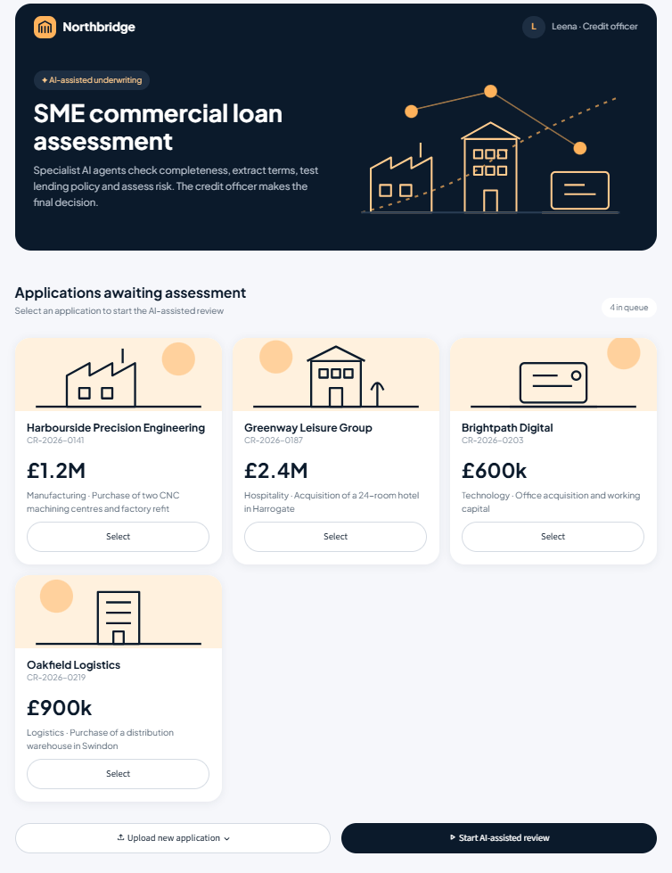
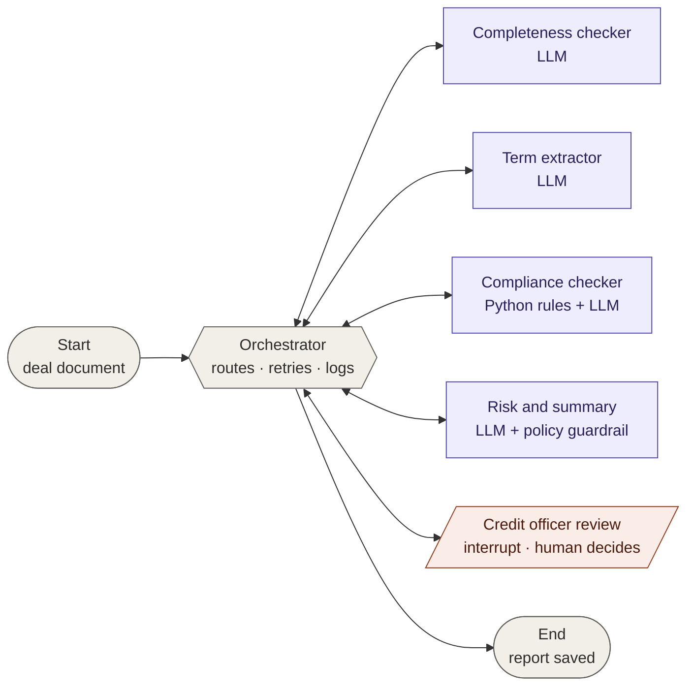
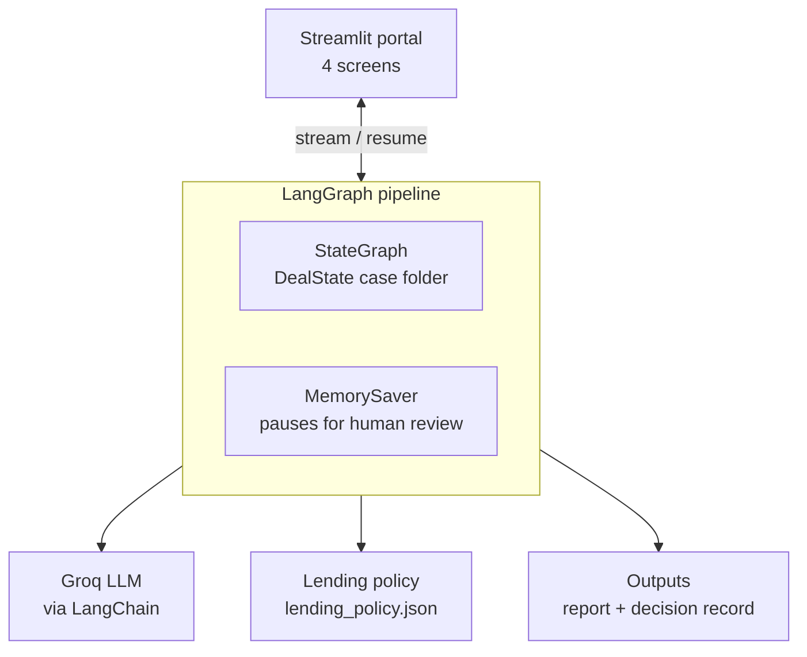
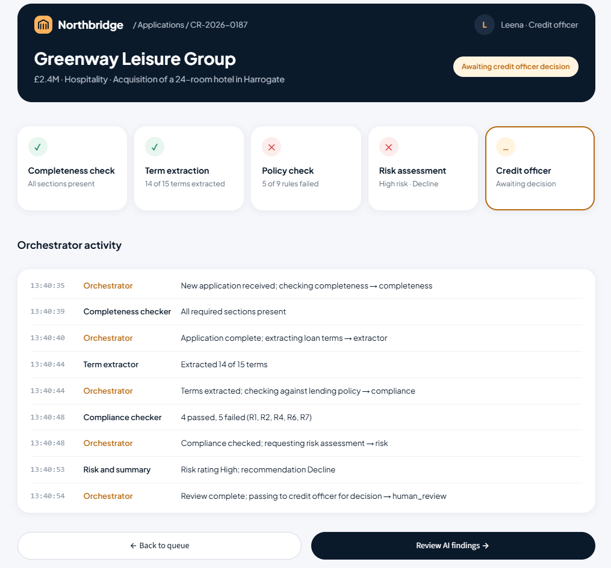
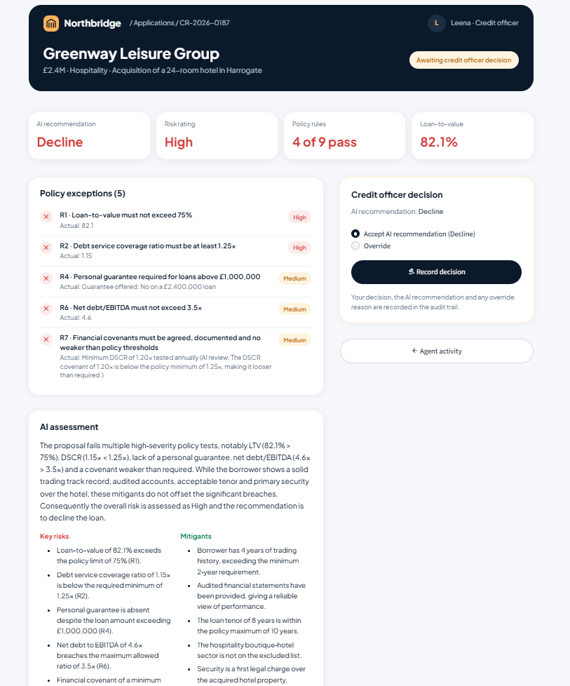
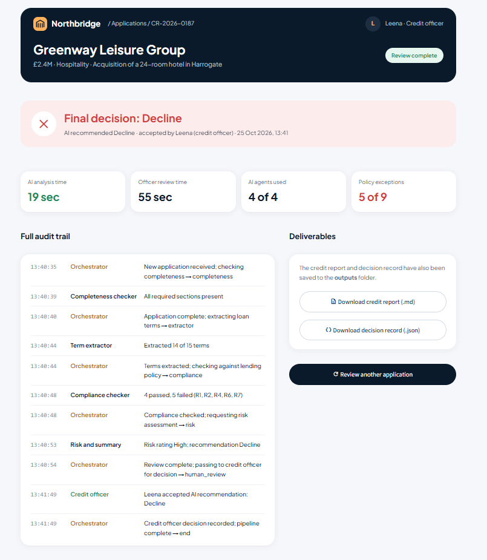

# Multi-Agent SME Loan Underwriting Pipeline

An AI-assisted deal review system for **SME commercial lending**. Specialist AI agents check an application for completeness, extract the loan terms, test them against lending policy and assess the risk. An orchestrator coordinates the agents, and a **human credit officer makes the final decision**.

Built with **LangGraph**, **LangChain** and the **Groq API**, with a **Streamlit** front end.

> Week 3 project (Project 3B: Multi-Agent Deal Review Pipeline) for the Agentic AI certification at Gen Academy.



---

## Contents

- [The problem](#the-problem)
- [The solution](#the-solution)
- [Architecture](#architecture)
- [The agents](#the-agents)
- [Key design decisions](#key-design-decisions)
- [The demo portal](#the-demo-portal)
- [Sample deals and outputs](#sample-deals-and-outputs)
- [Getting started](#getting-started)
- [Project structure](#project-structure)
- [Lessons learned](#lessons-learned)
- [Production considerations](#production-considerations)
- [Known limitations](#known-limitations)
- [Disclaimer](#disclaimer)

---

## The problem

A bank's commercial lending team receives credit applications from small and medium-sized businesses seeking secured term loans of £250k–£5M. Each application arrives as an unstructured document: a term sheet and short credit memo covering the borrower, loan terms, collateral and financials.

Before a credit committee can decide, an analyst has to manually:

1. Read the document and extract the key loan terms
2. Check those terms against the bank's lending policy (LTV caps, minimum debt service cover, maximum tenor, covenants, KYC)
3. Assess the overall risk and write a recommendation

This first-line review takes hours per application, varies between analysts, and policy breaches can be missed at high volumes. The reasoning behind each recommendation is often poorly documented, which creates audit and regulatory exposure.

**Objective:** perform the first-line underwriting review of an SME loan application in minutes, producing a consistent, policy-checked and fully auditable recommendation for a human credit officer to accept or override.

---

## The solution

A multi-agent pipeline that mirrors how a credit team actually works:

| Step | Who does it | What happens |
|---|---|---|
| 1 | **Completeness checker** (AI) | Confirms all required sections of the application are present |
| 2 | **Term extractor** (AI) | Reads the document and fills in a structured loan terms form |
| 3 | **Compliance checker** (Python + AI) | Tests every term against the lending policy |
| 4 | **Risk and summary** (AI) | Rates the risk, lists risks and mitigants, recommends Approve / Refer / Decline |
| 5 | **Credit officer** (human) | Reviews the AI's work and accepts or overrides the recommendation |

An **orchestrator** sits at the centre, deciding which step runs next and recording every hand-off in an audit trail.

---

## Architecture

### Agent graph

A hub-and-spoke LangGraph. Every node hands control back to the orchestrator, which reads the shared state and routes to the next step.



**Routing paths the orchestrator supports:**

- **Full review:** completeness → extraction → compliance → risk → credit officer
- **Short-circuit:** an incomplete application skips straight to the credit officer
- **Retry:** if mandatory terms are missing after extraction, the document goes back to the extractor once with a note on what was missed

### System view



### How the agents communicate

Agents never call each other directly. They share a **case folder**, the `DealState`:

- Each agent reads what it needs from the folder and writes only its own slot (`completeness`, `terms`, `compliance_results`, `risk`, `human_decision`).
- Agent outputs are **structured Pydantic models**, a fixed contract between agents rather than free text.
- The `audit_log` uses a LangGraph **reducer** (`operator.add`), so every agent appends to the log instead of overwriting it.

### Human in the loop

The credit officer review uses LangGraph's `interrupt()`. The graph **pauses**, `MemorySaver` saves the full case folder under the review's `thread_id`, and the graph **resumes** with `Command(resume=decision)` once the officer accepts or overrides. Every complete deal goes to a human: the system recommends, it never decides.

---

## The agents

| Node | Powered by | Reads | Writes | Notes |
|---|---|---|---|---|
| `orchestrator` | Plain Python | Whole state | `next_step`, audit log | No LLM, so routing is predictable and auditable |
| `completeness` | LLM | Document, required sections | `completeness` | Triggers the short-circuit if sections are missing |
| `extractor` | LLM | Document | `terms` | Structured output; returns `null` rather than guessing |
| `compliance` | Python + LLM | Terms, policy | `compliance_results` | Python for numeric rules; LLM only for covenant adequacy |
| `risk` | LLM + Python guardrail | Terms, rule results | `risk` | AI can be stricter than policy, never more lenient |
| `human_review` | Human | Review pack | `human_decision` | `interrupt()` pauses the graph; override requires a reason |

### Lending policy

Nine rules, defined in `data/lending_policy.json` so thresholds can change without touching code:

| Rule | Requirement | Severity |
|---|---|---|
| R1 | Loan-to-value ≤ 75% | High |
| R2 | Debt service coverage ratio ≥ 1.25x | High |
| R3 | Tenor ≤ 10 years | Medium |
| R4 | Personal guarantee required above £1,000,000 | Medium |
| R5 | At least 2 years' trading history | High |
| R6 | Net debt / EBITDA ≤ 3.5x | Medium |
| R7 | Covenants agreed and no weaker than policy (LLM review) | Medium |
| R8 | KYC complete and audited accounts provided | High |
| R9 | Sector not on the excluded list | High |

---

## Key design decisions

**1. Deterministic code where correctness is non-negotiable, AI where judgement is needed.**
Numeric policy checks, routing and the recommendation floor are plain Python. A regulator should never have to ask why a language model decided whether 82.1 is above 75. The LLM is used for reading documents, interpreting covenant wording and writing the risk narrative.

**2. AI judgement inside policy guardrails.**
Python calculates the most lenient outcome the policy allows: any high-severity breach means at least Decline, and any medium breach or unverified rule means at least Refer. The risk agent may recommend something stricter, but if it is more lenient, the guardrail overrides it and logs the override.

**3. Structured contracts between agents.**
Each agent fills in a Pydantic model. Every field is optional, so a missing value comes back as `null` and the compliance checker marks the rule `UNABLE_TO_VERIFY`, rather than the extractor inventing a number.

**4. The orchestrator checks terminal conditions first.**
A recorded human decision ends the pipeline regardless of anything else in the state. This came from a bug found during testing (see [Lessons learned](#lessons-learned)).

**5. A human makes every final decision.**
The AI recommendation and the human decision are stored separately, along with who decided, when, and the reason for any override.

---

## The demo portal

A Streamlit front end for a fictional bank, **Northbridge**, with four screens that follow a deal from queue to decision. The UI contains no agent logic: it calls the same graph as the command-line version.

| Screen | What it shows | Behind the scenes |
|---|---|---|
| **1. Application queue** | Applications awaiting assessment | Tile details read from the documents with simple text matching |
| **2. AI agents at work** | Step cards that update live, plus the orchestrator activity feed | `graph.stream()`, redrawing after each node finishes |
| **3. Credit officer review** | Key metrics, policy exceptions, AI assessment, accept / override panel | `graph.get_state()` reads the paused review |
| **4. Decision recorded** | Outcome, override reason, AI and officer timings, audit trail, downloads | `graph.invoke(Command(resume=...))`, then the report is saved |

| | |
|---|---|
|  |  |
|  | |

---

## Sample deals and outputs

Three sample applications in `data/` exercise the three paths through the graph:

| Deal | Scenario | Expected outcome |
|---|---|---|
| `deal_a_clean.txt` | Harbourside Precision Engineering, £1.2M manufacturing loan, all terms within policy | 9/9 rules pass → Low risk → **Approve** |
| `deal_b_breach.txt` | Greenway Leisure Group, £2.4M hotel acquisition with planted breaches | 5 rules fail (R1, R2, R4, R6, R7) → High risk → **Decline** |
| `deal_c_incomplete.txt` | Brightpath Digital, £600k with Collateral and Financials missing | Short-circuit → **Refer** without AI assessment |

Deal B includes a deliberately subtle breach: its DSCR covenant is set at 1.20x, below the 1.25x policy minimum. A simple "is there a covenant?" check would pass it. The LLM covenant review catches it.

Each completed review writes two files to `outputs/`:

- **`<deal>_review.md`**: a formatted credit paper with decision, terms, policy results, AI assessment and audit trail
- **`<deal>_decision.json`**: the same information in machine-readable form

See [`outputs/deal_b_breach_review.md`](outputs/deal_b_breach_review.md) for an example with a credit officer override.

### Example audit trail (Deal B)

```
Orchestrator          New application received; checking completeness → completeness
Completeness checker  All required sections present
Orchestrator          Application complete; extracting loan terms → extractor
Term extractor        Extracted 14 of 15 terms
Orchestrator          Terms extracted; checking against lending policy → compliance
Compliance checker    4 passed, 5 failed (R1, R2, R4, R6, R7)
Orchestrator          Compliance checked; requesting risk assessment → risk
Risk and summary      Risk rating High; recommendation Decline
Orchestrator          Review complete; passing to credit officer for decision → human_review
Credit officer        Leena overrode AI recommendation (Decline → Refer). Reason: Strong sponsor
                      relationship; refer to committee to explore restructuring with additional security
Orchestrator          Credit officer decision recorded; pipeline complete → end
```

---

## Getting started

### Prerequisites

- Python 3.11 or later
- A free Groq API key from [console.groq.com](https://console.groq.com)

### Setup

```bash
git clone https://github.com/<your-username>/loan-underwriting-agents.git
cd loan-underwriting-agents

python -m venv venv
# Windows PowerShell
venv\Scripts\Activate.ps1
# macOS / Linux
source venv/bin/activate

pip install -r requirements.txt
```

Create a `.env` file in the project root:

```
GROQ_API_KEY=your_key_here
GROQ_MODEL=openai/gpt-oss-120b
```

Groq retires models regularly, so check the Models page in the Groq console and update `GROQ_MODEL` if needed.

### Run the portal

```bash
streamlit run app.py
```

Opens at `http://localhost:8501`. Select an application and click **Start AI-assisted review**.

### Run from the command line

```bash
python run_pipeline.py deal_a_clean.txt
python run_pipeline.py deal_b_breach.txt
python run_pipeline.py deal_c_incomplete.txt
```

The pipeline pauses for your decision in the terminal.

### Test individual agents

```bash
python test_completeness.py
python test_extractor.py
python test_compliance.py
python test_risk.py
```

---

## Project structure

```
loan-underwriting-agents/
├── agents/
│   ├── orchestrator.py      # Routing logic: decides the next step
│   ├── completeness.py      # Agent 1: required sections present?
│   ├── extractor.py         # Agent 2: structured loan terms
│   ├── compliance.py        # Agent 3: policy rules (Python + LLM)
│   ├── risk.py              # Agent 4: risk rating, guardrail, summary
│   └── human_review.py      # Credit officer review with interrupt()
├── ui/
│   ├── theme.py             # Palette and styling
│   ├── illustrations.py     # Logo, hero and sector drawings (SVG)
│   ├── deals.py             # Reads tile details from documents
│   ├── components.py        # Hero, deal cards, step board, activity feed
│   ├── progress.py          # Maps graph updates to step card states
│   ├── officer_review.py    # Screen 3 components
│   └── decision.py          # Screen 4 components
├── data/
│   ├── deal_a_clean.txt
│   ├── deal_b_breach.txt
│   ├── deal_c_incomplete.txt
│   └── lending_policy.json
├── outputs/                 # Generated reports and decision records
├── .streamlit/config.toml   # Streamlit base theme
├── app.py                   # Streamlit portal
├── graph.py                 # Builds and compiles the LangGraph
├── state.py                 # DealState and audit log helper
├── models.py                # Pydantic contracts between agents
├── llm.py                   # Shared Groq model
├── report.py                # Markdown report and JSON record
├── run_pipeline.py          # Command-line version
└── requirements.txt
```

---

## Lessons learned

**Information is lost at hand-offs.** The extractor originally recorded the personal guarantee as a simple yes/no. The guarantee was limited to £300k on a £1.2M loan, so the risk agent, seeing only "yes", described it as covering the full exposure. The fix was to enrich the shared data contract (`guarantee_details`, `collateral_description`) rather than passing the raw document downstream, keeping agents communicating through structured data only.

**LLMs invent plausible facts unless grounded.** An early risk assessment listed "customer concentration" as a risk, which appeared nowhere in the application. Explicit grounding rules in the prompt removed it. A later fix overcorrected and produced empty risk lists, which showed how sensitive prompts are to wording.

**Prompts guide behaviour but don't guarantee it.** Output wording varies between runs, and some instructions are followed inconsistently. This shaped the core design: anything that must be right every time (policy rules, the recommendation floor, routing) is deterministic code, and the human review catches the rest.

**Test every path, not just the happy one.** Testing the incomplete application revealed a routing loop: after the officer decided, the orchestrator matched the "incomplete" rule again and sent the deal back for review. Checking terminal conditions first fixed it.

**Domain judgement is part of evaluation.** Several issues, such as invented risks, a mis-described guarantee and padded mitigants, produced no errors at all. They were only visible to someone reading the output as a credit officer would.

---

## Production considerations

- **Persistent checkpointing.** `MemorySaver` keeps state in memory. In production this would be a PostgreSQL checkpointer, so reviews survive restarts and officers can respond hours or days later.
- **Provenance for every extracted value.** Each term would carry a source citation (quote and section reference), so credit officers can verify figures instantly and the bank can evidence traceability under model risk management requirements such as PRA SS1/23.
- **Cross-deal memory.** LangGraph's Store could hold long-term context such as prior borrower history or override patterns.
- **Evaluation suite.** A labelled set of applications with expected terms and outcomes, run on every prompt or model change to catch regressions.
- **Straight-through processing.** Clean, low-risk deals could bypass manual review, with only exceptions routed to a human. This demo sends every deal to a human, the more realistic position for a regulated lender today.
- **Document ingestion.** PDF and scanned document support, with OCR, would replace the current plain-text format.

---

## Known limitations

- Uploaded applications must follow the same plain-text structure and section headings as the sample deals.
- The risk agent sometimes lists policy compliance (for example, "tenor within limit") as a mitigant. A credit officer would discount this, which is part of why every deal goes to human review.
- The AI analysis time shown in the portal includes a deliberate 0.6-second pause between steps (`DEMO_PACING` in `app.py`) so the demo is easy to follow. Set it to `0` for real timings.
- Results depend on the Groq model in use. Outputs were validated with `openai/gpt-oss-120b`.

---

## Tech stack

| Layer | Technology |
|---|---|
| Orchestration | LangGraph (`StateGraph`, conditional edges, `interrupt`, `MemorySaver`) |
| LLM framework | LangChain (`ChatPromptTemplate`, `with_structured_output`) |
| Model | Groq API (`openai/gpt-oss-120b`) |
| Data contracts | Pydantic |
| Front end | Streamlit |

---

## Disclaimer

Northbridge Bank is a **fictional bank** created for this demonstration. All borrowers, deals and figures are invented. This project is not affiliated with any financial institution, and its outputs are not credit or financial advice.